# Go learning roadmap

Follow the stages in order. Allow roughly **10–14 weeks at 6–10 hours/week**, or move
slower if programming itself is new. These are flexible study estimates, not a deadline.
Finish a stage's completion gate before moving on; later hard assignments intentionally
combine several earlier topics. Read lessons 00–04 before trying complex server code.

## The learning loop

1. Read the lesson and draw its architecture/ownership diagram in your own words.
2. Run a complete example, predict its output, then change one input or behavior.
3. Read an assignment contract and tests; implement only its starter package.
4. Run its tests, add one meaningful edge case, and explain complexity and failure paths.
5. Read the matching `/solutions` explanation after a real attempt; close it and reimplement.
6. For concurrent work run -race and explain cancellation and goroutine exit conditions.

```mermaid
flowchart LR
    SETUP[Setup] --> CORE[Types, functions, errors]
    CORE --> DATA[Slices, maps, strings, structs]
    DATA --> PARSE[JSON, CSV, file I/O]
    PARSE --> DS[STL equivalents and algorithms]
    DS --> CONC[Goroutines, locks, channels, context]
    CONC --> NET[TCP, UDP, DNS and HTTP]
    NET --> TLS[HTTPS and lifecycle]
    TLS --> ADV[Caches, pipelines, architecture, diagnostics]
    ADV --> REPAIR[Repository repair interviews]
```



## Stage plan

| Stage | Lessons | Practice, in this order | Completion gate |
| --- | --- | --- | --- |
| 0 | 00 setup | examples/basics | Run, format, build, test; understand module/package |
| 1 | 01 basics; 04 functions/errors | easy/01-statistics; easy/05-account | Types, branches, loops, errors, methods, pointers |
| 2 | 02 collections; 03 text | easy/02-unicode-words; easy/03-slice-rotation; easy/04-maps-sets | UTF-8, backing arrays, hash keys, deterministic output |
| 3 | 06 JSON/CSV | easy/06-json; easy/07-csv | Strict input, required fields, quote-aware records |
| 4 | 05 data structures | medium/01-containers; medium/02-top-k; medium/03-bfs | Generics, FIFO/LIFO, heap, graph, complexity |
| 5 | 07 files/system | medium/04-stream-reader; examples/system | Reader interfaces, bounds, processes, close ownership |
| 6 | 08 concurrency; 09 context/time | medium/05-counter; medium/06-worker-pool | Locks, channels, goroutines, cancellation, joining |
| 7 | 10 HTTP | medium/07-http-handler; hard/04-http-client | Routing, JSON boundary, request/response lifecycle |
| 8 | 11 networking | hard/03-tcp-frames; network examples | TCP/UDP/DNS, partial I/O, framing, deadlines |
| 9 | 12 HTTPS | hard/05-https; examples/certgen; examples/https-server | Certificates, trust, TLS handshake, graceful shutdown |
| 10 | 05 DS revisit; 09 time revisit | hard/01-lru; hard/02-ttl-cache; hard/07-dijkstra | Combine DS, clock injection, weighted shortest paths |
| 11 | 13 architecture; 14 testing/debugging | hard/06-csv-pipeline; examples/testing-tools | Bounded stages, one state owner, fuzz/profile/test |
| 12 | Interview practice | interviews/repair-shop then upstream catalogue | Read an unfamiliar repo, reproduce, fix, explain |

Lesson files use exact numbered names in [lessons/README.md](lessons/README.md).
Assignment links and commands are listed in [assignments/README.md](assignments/README.md).
For every task there is a matching path under `solutions/`, including explanatory README files.

## Study checkpoints

- **After stage 3:** build a small typed CLI that reads values, validates them and prints JSON. Explain slice aliasing and error propagation.
- **After stage 6:** use a bounded worker pool, stop it mid-flight and show every goroutine exits. Explain why WaitGroup does not protect data.
- **After stage 9:** serve HTTPS using only net/http and crypto/tls. Validate the certificate with a supplied trust root, then stop cleanly with Ctrl+C.
- **After stage 11:** trace bytes through Reader -> parser -> worker -> reducer -> output. Explain ownership, backpressure, limits and cancellation.
- **After stage 12:** fix reported bugs in an unfamiliar codebase, add regressions and present a short architecture/fix explanation.

## Daily commands

```sh
make test                              # reference answers and runnable examples
make check ID=easy/03-slice-rotation     # active tests for your work
make check ID=medium/06-worker-pool      # also uses -race
make repair                            # intentionally fails until repair lab is fixed
make verify                            # curriculum integrity and reference checks
make clone-interviews                  # needs Git + working GitHub network access
```

The exercise tests are active from the start. A TODO panic is a deliberate starting
point, not a broken installation. `go test ./...` includes unsolved work and fails;
`make test` checks completed code. Do not copy reference answers into the starter before
attempting it. Test copies under solutions are identical to the supplied learner tests;
add your own regressions to the learner side as you progress.

## What to use as a reference

- [C++ STL mapping](docs/stl-to-go.md): vectors, queues, sets, hash maps, ordered containers, heaps and lists.
- [Standard-library cheat sheet](docs/stdlib-cheatsheet.md): strings, slices, JSON, CSV, files, errors and HTTP; JavaScript equivalents included.
- [System/network call map](docs/system-network-calls.md): how Go APIs reach sockets, files and processes.
- [Advanced study](docs/advanced-study.md): runtime, reflection, profiling, SQL, ordered trees and distributed-system follow-ons.
- [Official documentation](docs/resources.md) and [interview catalogue](interviews/README.md).

The curriculum covers beginner through substantial intermediate/advanced backend practice;
no single repository can exhaust the whole Go ecosystem. Advanced follow-ons are explicitly
identified as study directions rather than prebuilt graded assignments. External company
challenges are not uniformly Go or 500–600 lines. Their status and task type are recorded
honestly; the included original repair lab supplies that compact Go practice format.
