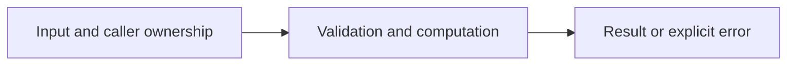

# Statistics and control flow

Difficulty: **easy**. Read [the lesson](../../../lessons/01-basics.md) first.

## Contract

Implement Stats(nums []int) (min, max, sum int, mean float64, err error).
Reject empty input. Do not change nums. Values and their sum fit in int.
For [2, -1, 5], return (-1, 5, 6, 2, nil).

## Architecture



```text
Input slice --> one pass accumulator --> statistics or error
```

Before coding, name who owns each mutable value and resource. For concurrent code,
name each goroutine's exit condition and which sender closes each channel.

## Work

1. Read `exercise.go` and `exercise_test.go`. Keep the exported API.
2. Replace TODO panics in `exercise.go`; do not import the reference answer.
3. Add a regression case in a new `regression_test.go`; keep supplied tests intact.
4. Explain time/space complexity and the ownership or cancellation contract.

From the workspace root:

```sh
go test -count=1 -timeout=30s ./assignments/easy/01-statistics
go test -race -count=1 -timeout=30s ./assignments/easy/01-statistics
```

Tests intentionally fail until implemented. The supplied tests are acceptance examples,
not proof of correctness; review complexity and lifecycle guarantees too.
See [the explained solution](../../../solutions/easy/01-statistics/README.md) only after attempting it.
