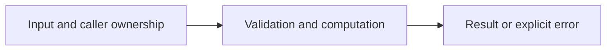

# Unicode text normalization

Difficulty: **easy**. Read [the lesson](../../../lessons/03-text.md) first.

## Contract

Implement Words(text string) []string. Split on whitespace with strings.Fields,
lowercase using strings.ToLower, and trim Unicode punctuation only from each token's ends.
Drop tokens that become empty. Preserve internal punctuation: "don't" stays "don't".
Example: "  Hello, WORLD! ... café  " -> ["hello", "world", "café"].

## Architecture



```text
UTF-8 text --> whitespace tokens --> Unicode trim and lowercase --> word slice
```

Before coding, name who owns each mutable value and resource. For concurrent code,
name each goroutine's exit condition and which sender closes each channel.

## Work

1. Read `exercise.go` and `exercise_test.go`. Keep the exported API.
2. Replace TODO panics in `exercise.go`; do not import the reference answer.
3. Add a regression case in a new `regression_test.go`; keep supplied tests intact.
4. Explain time/space complexity and the ownership or cancellation contract.

From the workspace root:

```sh
go test -count=1 -timeout=30s ./assignments/easy/02-unicode-words
go test -race -count=1 -timeout=30s ./assignments/easy/02-unicode-words
```

Tests intentionally fail until implemented. The supplied tests are acceptance examples,
not proof of correctness; review complexity and lifecycle guarantees too.
See [the explained solution](../../../solutions/easy/02-unicode-words/README.md) only after attempting it.
