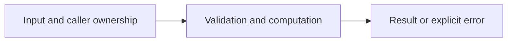

# Slices, indexing, and ownership

Difficulty: **easy**. Read [the lesson](../../../lessons/02-collections.md) first.

## Contract

Implement RotateLeft(nums []int, k int) []int. Return a new slice rotated left by k.
Negative k rotates right. Empty input returns an empty result. Do not mutate or alias input.
[1,2,3,4], k=5 -> [2,3,4,1]; k=-1 -> [4,1,2,3].

## Architecture



```text
Caller backing array --> normalized offset --> newly allocated backing array
```

Before coding, name who owns each mutable value and resource. For concurrent code,
name each goroutine's exit condition and which sender closes each channel.

## Work

1. Read `exercise.go` and `exercise_test.go`. Keep the exported API.
2. Replace TODO panics in `exercise.go`; do not import the reference answer.
3. Add a regression case in a new `regression_test.go`; keep supplied tests intact.
4. Explain time/space complexity and the ownership or cancellation contract.

From the workspace root:

```sh
go test -count=1 -timeout=30s ./assignments/easy/03-slice-rotation
go test -race -count=1 -timeout=30s ./assignments/easy/03-slice-rotation
```

Tests intentionally fail until implemented. The supplied tests are acceptance examples,
not proof of correctness; review complexity and lifecycle guarantees too.
See [the explained solution](../../../solutions/easy/03-slice-rotation/README.md) only after attempting it.
