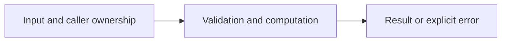

# Hash maps and sets

Difficulty: **easy**. Read [the lesson](../../../lessons/02-collections.md) first.

## Contract

Implement Frequency(words []string) map[string]int and UniqueSorted(nums []int) []int.
Count exact strings (case sensitive). UniqueSorted must deduplicate and sort ascending
without changing nums. Empty inputs are valid. No assumptions about map iteration order.

## Architecture



```text
Input --> hash map frequency or membership --> sorted deterministic output
```

Before coding, name who owns each mutable value and resource. For concurrent code,
name each goroutine's exit condition and which sender closes each channel.

## Work

1. Read `exercise.go` and `exercise_test.go`. Keep the exported API.
2. Replace TODO panics in `exercise.go`; do not import the reference answer.
3. Add a regression case in a new `regression_test.go`; keep supplied tests intact.
4. Explain time/space complexity and the ownership or cancellation contract.

From the workspace root:

```sh
go test -count=1 -timeout=30s ./assignments/easy/04-maps-sets
go test -race -count=1 -timeout=30s ./assignments/easy/04-maps-sets
```

Tests intentionally fail until implemented. The supplied tests are acceptance examples,
not proof of correctness; review complexity and lifecycle guarantees too.
See [the explained solution](../../../solutions/easy/04-maps-sets/README.md) only after attempting it.
