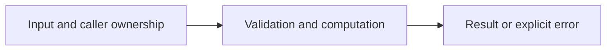

# Structs, methods, and errors

Difficulty: **easy**. Read [the lesson](../../../lessons/04-functions-errors.md) first.

## Contract

Implement NewAccount(cents int64) (*Account,error), Deposit(cents int64) error,
Withdraw(cents int64) error and Balance() int64. Reject negative starting balance,
non-positive transactions, overdrafts, and int64 overflow. Failed operations leave balance
unchanged. Account is used by one goroutine only. Store integer cents, not floats.

## Architecture



```text
Validated transaction --> Account owns balance --> updated balance or unchanged on error
```

Before coding, name who owns each mutable value and resource. For concurrent code,
name each goroutine's exit condition and which sender closes each channel.

## Work

1. Read `exercise.go` and `exercise_test.go`. Keep the exported API.
2. Replace TODO panics in `exercise.go`; do not import the reference answer.
3. Add a regression case in a new `regression_test.go`; keep supplied tests intact.
4. Explain time/space complexity and the ownership or cancellation contract.

From the workspace root:

```sh
go test -count=1 -timeout=30s ./assignments/easy/05-account
go test -race -count=1 -timeout=30s ./assignments/easy/05-account
```

Tests intentionally fail until implemented. The supplied tests are acceptance examples,
not proof of correctness; review complexity and lifecycle guarantees too.
See [the explained solution](../../../solutions/easy/05-account/README.md) only after attempting it.
