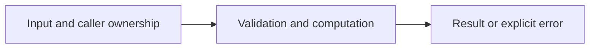

# Strict JSON parsing

Difficulty: **easy**. Read [the lesson](../../../lessons/06-json-csv.md) first.

## Contract

Implement DecodeProfile(data []byte) (Profile,error). Profile has JSON fields name and age.
Require a nonblank name and an explicitly present, nonnegative integer age. Reject null,
missing fields, unknown fields, malformed JSON, wrong types, and additional JSON values.
Preserve the supplied name. Duplicate object keys follow encoding/json's last-value behavior.

## Architecture



```text
JSON bytes --> decoder with strict field checks --> validated Profile
```

Before coding, name who owns each mutable value and resource. For concurrent code,
name each goroutine's exit condition and which sender closes each channel.

## Work

1. Read `exercise.go` and `exercise_test.go`. Keep the exported API.
2. Replace TODO panics in `exercise.go`; do not import the reference answer.
3. Add a regression case in a new `regression_test.go`; keep supplied tests intact.
4. Explain time/space complexity and the ownership or cancellation contract.

From the workspace root:

```sh
go test -count=1 -timeout=30s ./assignments/easy/06-json
go test -race -count=1 -timeout=30s ./assignments/easy/06-json
```

Tests intentionally fail until implemented. The supplied tests are acceptance examples,
not proof of correctness; review complexity and lifecycle guarantees too.
See [the explained solution](../../../solutions/easy/06-json/README.md) only after attempting it.
