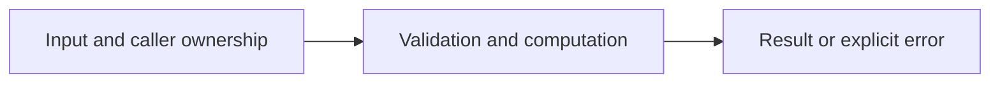

# CSV records and validation

Difficulty: **easy**. Read [the lesson](../../../lessons/06-json-csv.md) first.

## Contract

Implement ReadScores(r io.Reader) ([]Score,error). Header must be exactly name,score.
Each subsequent CSV record must have two fields, a nonblank name and an integer score
from 0 to 100. Honor quoted commas/newlines. Empty data or any bad record returns an
error and no partial result. Header-only input is valid. Preserve names as supplied.

## Architecture



```text
io.Reader --> encoding/csv records --> validated Score slice
```

Before coding, name who owns each mutable value and resource. For concurrent code,
name each goroutine's exit condition and which sender closes each channel.

## Work

1. Read `exercise.go` and `exercise_test.go`. Keep the exported API.
2. Replace TODO panics in `exercise.go`; do not import the reference answer.
3. Add a regression case in a new `regression_test.go`; keep supplied tests intact.
4. Explain time/space complexity and the ownership or cancellation contract.

From the workspace root:

```sh
go test -count=1 -timeout=30s ./assignments/easy/07-csv
go test -race -count=1 -timeout=30s ./assignments/easy/07-csv
```

Tests intentionally fail until implemented. The supplied tests are acceptance examples,
not proof of correctness; review complexity and lifecycle guarantees too.
See [the explained solution](../../../solutions/easy/07-csv/README.md) only after attempting it.
