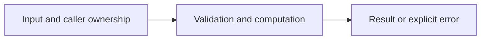

# LRU cache: map plus linked list

Difficulty: **hard**. Read [the lesson](../../../lessons/05-data-structures.md) first.

## Contract

Implement NewLRU(capacity int) *LRU, Get(key string)(int,bool), Put(key string,value int),
and Len() int. NewLRU treats capacity<=0 as disabled storage. Get and updates refresh
recency. Inserting into a full cache evicts the least recently used entry. Use a map
and container/list for expected O(1) operations. Sequential use only.

## Architecture



```text
Key --> map lookup --> doubly linked recency list (front newest, back oldest)
```

Before coding, name who owns each mutable value and resource. For concurrent code,
name each goroutine's exit condition and which sender closes each channel.

## Work

1. Read `exercise.go` and `exercise_test.go`. Keep the exported API.
2. Replace TODO panics in `exercise.go`; do not import the reference answer.
3. Add a regression case in a new `regression_test.go`; keep supplied tests intact.
4. Explain time/space complexity and the ownership or cancellation contract.

From the workspace root:

```sh
go test -count=1 -timeout=30s ./assignments/hard/01-lru
go test -race -count=1 -timeout=30s ./assignments/hard/01-lru
```

Tests intentionally fail until implemented. The supplied tests are acceptance examples,
not proof of correctness; review complexity and lifecycle guarantees too.
See [the explained solution](../../../solutions/hard/01-lru/README.md) only after attempting it.
