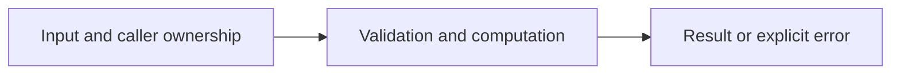

# Concurrent TTL cache and clock injection

Difficulty: **hard**. Read [the lesson](../../../lessons/09-context-time.md) first.

## Contract

Implement NewCache(now func() time.Time) *Cache, Set(key,value string,ttl time.Duration),
Get(key string)(string,bool), and Prune() int. nil clock uses time.Now. Entries expire when
now>=expiresAt, including the exact boundary. ttl<=0 removes that key. Get deletes expired
entries. Prune removes all expired entries and returns their count. All methods are safe
for concurrent use. The injected clock must itself be concurrency safe. No background worker.

## Architecture



```text
Concurrent callers --> mutex --> entry map; injected clock --> expiration decisions
```

Before coding, name who owns each mutable value and resource. For concurrent code,
name each goroutine's exit condition and which sender closes each channel.

## Work

1. Read `exercise.go` and `exercise_test.go`. Keep the exported API.
2. Replace TODO panics in `exercise.go`; do not import the reference answer.
3. Add a regression case in a new `regression_test.go`; keep supplied tests intact.
4. Explain time/space complexity and the ownership or cancellation contract.

From the workspace root:

```sh
go test -count=1 -timeout=30s ./assignments/hard/02-ttl-cache
go test -race -count=1 -timeout=30s ./assignments/hard/02-ttl-cache
```

Tests intentionally fail until implemented. The supplied tests are acceptance examples,
not proof of correctness; review complexity and lifecycle guarantees too.
See [the explained solution](../../../solutions/hard/02-ttl-cache/README.md) only after attempting it.
