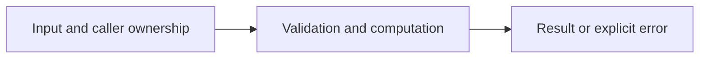

# TCP framing and partial I/O

Difficulty: **hard**. Read [the lesson](../../../lessons/11-network.md) first.

## Contract

Implement WriteFrame(w io.Writer,payload []byte) error and ReadFrame(r io.Reader)([]byte,error).
Wire format: uint32 big-endian length followed by that many bytes. Max payload 1 MiB.
Reject oversized advertised lengths before allocation. Empty frames are valid. Support
short reads/writes. Truncated headers/bodies and write failures return errors; a writer
returning (0,nil) must return io.ErrShortWrite. Do not close caller-owned streams.

## Architecture



```text
Payload --> 4-byte length + body --> TCP byte stream --> io.ReadFull --> payload
```

Before coding, name who owns each mutable value and resource. For concurrent code,
name each goroutine's exit condition and which sender closes each channel.

## Work

1. Read `exercise.go` and `exercise_test.go`. Keep the exported API.
2. Replace TODO panics in `exercise.go`; do not import the reference answer.
3. Add a regression case in a new `regression_test.go`; keep supplied tests intact.
4. Explain time/space complexity and the ownership or cancellation contract.

From the workspace root:

```sh
go test -count=1 -timeout=30s ./assignments/hard/03-tcp-frames
go test -race -count=1 -timeout=30s ./assignments/hard/03-tcp-frames
```

Tests intentionally fail until implemented. The supplied tests are acceptance examples,
not proof of correctness; review complexity and lifecycle guarantees too.
See [the explained solution](../../../solutions/hard/03-tcp-frames/README.md) only after attempting it.
