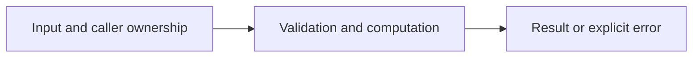

# Bounded HTTP JSON client

Difficulty: **hard**. Read [the lesson](../../../lessons/10-http.md) first.

## Contract

Implement GetJSON(ctx context.Context, client *http.Client, url string, out any) error.
Send a GET using ctx and the supplied reusable client. Require status 200, bound body to
1 MiB, decode exactly one JSON value into out, and close response bodies on every path.
Reject nil client, invalid URL, malformed/trailing JSON, oversized responses and non-200.
Use the client's TLS settings; never disable verification. No retries required.

## Architecture



```text
Context --> reusable http.Client --> response status/limit checks --> JSON target; body always closed
```

Before coding, name who owns each mutable value and resource. For concurrent code,
name each goroutine's exit condition and which sender closes each channel.

## Work

1. Read `exercise.go` and `exercise_test.go`. Keep the exported API.
2. Replace TODO panics in `exercise.go`; do not import the reference answer.
3. Add a regression case in a new `regression_test.go`; keep supplied tests intact.
4. Explain time/space complexity and the ownership or cancellation contract.

From the workspace root:

```sh
go test -count=1 -timeout=30s ./assignments/hard/04-http-client
go test -race -count=1 -timeout=30s ./assignments/hard/04-http-client
```

Tests intentionally fail until implemented. The supplied tests are acceptance examples,
not proof of correctness; review complexity and lifecycle guarantees too.
See [the explained solution](../../../solutions/hard/04-http-client/README.md) only after attempting it.
