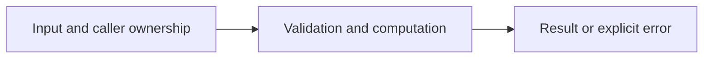

# Standard-library HTTPS server

Difficulty: **hard**. Read [the lesson](../../../lessons/12-https.md) first.

## Contract

Implement NewServer(addr string, handler http.Handler) *http.Server with Addr and Handler
as supplied; ReadHeaderTimeout 5s, ReadTimeout 10s, WriteTimeout 15s, IdleTimeout 60s,
MaxHeaderBytes 1 MiB and TLSConfig.MinVersion tls.VersionTLS12 or newer.
Implement Serve(ctx context.Context, srv *http.Server, listener net.Listener, certFile,keyFile string) error:
serve HTTPS using srv.ServeTLS; on cancellation gracefully shut down with a fresh 5s context,
force-close if shutdown fails, join the serve goroutine, and treat http.ErrServerClosed as normal.
Do not hide certificate/startup errors. The function owns the listener once invoked.
Read and run examples/https-server after completing this exercise.

## Architecture



```text
Listener --> TLS handshake --> HTTP server --> handler; ctx cancellation --> bounded shutdown --> join
```

Before coding, name who owns each mutable value and resource. For concurrent code,
name each goroutine's exit condition and which sender closes each channel.

## Work

1. Read `exercise.go` and `exercise_test.go`. Keep the exported API.
2. Replace TODO panics in `exercise.go`; do not import the reference answer.
3. Add a regression case in a new `regression_test.go`; keep supplied tests intact.
4. Explain time/space complexity and the ownership or cancellation contract.

From the workspace root:

```sh
go test -count=1 -timeout=30s ./assignments/hard/05-https
go test -race -count=1 -timeout=30s ./assignments/hard/05-https
```

Tests intentionally fail until implemented. The supplied tests are acceptance examples,
not proof of correctness; review complexity and lifecycle guarantees too.
See [the explained solution](../../../solutions/hard/05-https/README.md) only after attempting it.
