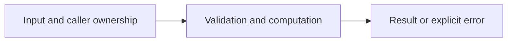

# Streaming CSV pipeline with workers

Difficulty: **hard**. Read [the lesson](../../../lessons/13-architecture.md) first.

## Contract

Implement Aggregate(ctx context.Context,r io.Reader,workers int)(map[string]int64,error).
CSV header is key,value; each row has nonblank key and base-10 signed int64 value.
Trim key whitespace. Sum values by key, checking overflow. Parse CSV on one goroutine,
feed a bounded channel (capacity<=workers) to workers for conversion, and aggregate results
on the calling goroutine. Reject workers<=0. Cancel and join all owned goroutines on error.
No partial map on error. ctx cancellation is cooperative between CSV reads: a generic
Reader blocked in Read cannot be forcibly interrupted; caller must unblock/close it.
Use an unbuffered results channel. Empty/header-only stream gives an empty map.

## Architecture



```text
CSV reader owner --> bounded row channel --> N converters --> one map owner; cancellation joins stages
```

Before coding, name who owns each mutable value and resource. For concurrent code,
name each goroutine's exit condition and which sender closes each channel.

## Work

1. Read `exercise.go` and `exercise_test.go`. Keep the exported API.
2. Replace TODO panics in `exercise.go`; do not import the reference answer.
3. Add a regression case in a new `regression_test.go`; keep supplied tests intact.
4. Explain time/space complexity and the ownership or cancellation contract.

From the workspace root:

```sh
go test -count=1 -timeout=30s ./assignments/hard/06-csv-pipeline
go test -race -count=1 -timeout=30s ./assignments/hard/06-csv-pipeline
```

Tests intentionally fail until implemented. The supplied tests are acceptance examples,
not proof of correctness; review complexity and lifecycle guarantees too.
See [the explained solution](../../../solutions/hard/06-csv-pipeline/README.md) only after attempting it.
