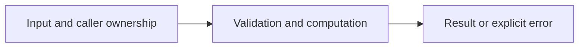

# Weighted shortest paths

Difficulty: **hard**. Read [the lesson](../../../lessons/05-data-structures.md) first.

## Contract

Implement ShortestDistance(graph map[string][]Edge,start,goal string)(int64,bool,error),
where Edge{To string;Weight int64}. Reject any negative edge in the supplied graph,
even if unreachable. Return distance,true,nil when reachable; 0,false,nil when not.
start==goal has distance zero after graph validation. Use a priority queue. If an encountered
relaxation overflows int64, return error. Do not mutate the graph.

## Architecture



```text
Weighted adjacency map --> min-distance heap --> relax edges --> shortest distance
```

Before coding, name who owns each mutable value and resource. For concurrent code,
name each goroutine's exit condition and which sender closes each channel.

## Work

1. Read `exercise.go` and `exercise_test.go`. Keep the exported API.
2. Replace TODO panics in `exercise.go`; do not import the reference answer.
3. Add a regression case in a new `regression_test.go`; keep supplied tests intact.
4. Explain time/space complexity and the ownership or cancellation contract.

From the workspace root:

```sh
go test -count=1 -timeout=30s ./assignments/hard/07-dijkstra
go test -race -count=1 -timeout=30s ./assignments/hard/07-dijkstra
```

Tests intentionally fail until implemented. The supplied tests are acceptance examples,
not proof of correctness; review complexity and lifecycle guarantees too.
See [the explained solution](../../../solutions/hard/07-dijkstra/README.md) only after attempting it.
