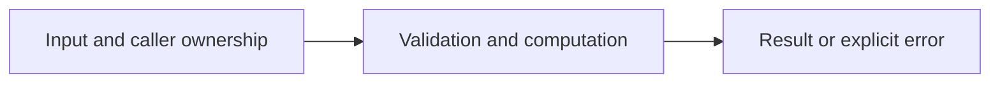

# Generic stack and queue

Difficulty: **medium**. Read [the lesson](../../../lessons/05-data-structures.md) first.

## Contract

Implement Stack[T any] with Push, Pop()(T,bool), Len, and Queue[T any] with
Push, Pop()(T,bool), Len. Zero values must work. Stack is LIFO, Queue is FIFO.
Empty Pop returns the zero T and false. Clear removed slots so references can be collected.
Neither type must be safe for concurrent use. Queue Push should be amortized O(1).

## Architecture



```text
Caller --> generic container API --> private slice / queue head --> value and presence
```

Before coding, name who owns each mutable value and resource. For concurrent code,
name each goroutine's exit condition and which sender closes each channel.

## Work

1. Read `exercise.go` and `exercise_test.go`. Keep the exported API.
2. Replace TODO panics in `exercise.go`; do not import the reference answer.
3. Add a regression case in a new `regression_test.go`; keep supplied tests intact.
4. Explain time/space complexity and the ownership or cancellation contract.

From the workspace root:

```sh
go test -count=1 -timeout=30s ./assignments/medium/01-containers
go test -race -count=1 -timeout=30s ./assignments/medium/01-containers
```

Tests intentionally fail until implemented. The supplied tests are acceptance examples,
not proof of correctness; review complexity and lifecycle guarantees too.
See [the explained solution](../../../solutions/medium/01-containers/README.md) only after attempting it.
