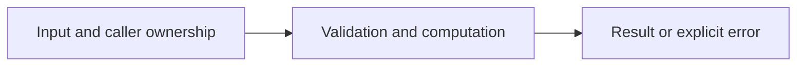

# Top K with a priority queue

Difficulty: **medium**. Read [the lesson](../../../lessons/05-data-structures.md) first.

## Contract

Implement TopK(nums []int,k int) []int. Return the largest k values descending,
preserving duplicates. k<=0 gives empty; k>len(nums) gives all. Do not mutate input.
Use container/heap with at most min(k,n) values, rather than sorting all input.

## Architecture



```text
Input stream --> size k min-heap --> descending result
```

Before coding, name who owns each mutable value and resource. For concurrent code,
name each goroutine's exit condition and which sender closes each channel.

## Work

1. Read `exercise.go` and `exercise_test.go`. Keep the exported API.
2. Replace TODO panics in `exercise.go`; do not import the reference answer.
3. Add a regression case in a new `regression_test.go`; keep supplied tests intact.
4. Explain time/space complexity and the ownership or cancellation contract.

From the workspace root:

```sh
go test -count=1 -timeout=30s ./assignments/medium/02-top-k
go test -race -count=1 -timeout=30s ./assignments/medium/02-top-k
```

Tests intentionally fail until implemented. The supplied tests are acceptance examples,
not proof of correctness; review complexity and lifecycle guarantees too.
See [the explained solution](../../../solutions/medium/02-top-k/README.md) only after attempting it.
