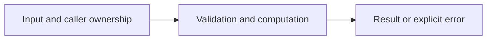

# Shortest unweighted path

Difficulty: **medium**. Read [the lesson](../../../lessons/05-data-structures.md) first.

## Contract

Implement ShortestPath(graph map[string][]string, start, goal string) ([]string,bool).
Graph is directed and unweighted. Return any shortest path including endpoints, or nil,false
if unreachable. start==goal returns [start],true even if absent from the map.
Handle cycles and nodes that appear only in adjacency lists. Do not mutate graph.

## Architecture



```text
Adjacency map --> FIFO frontier and visited parents --> reconstructed path
```

Before coding, name who owns each mutable value and resource. For concurrent code,
name each goroutine's exit condition and which sender closes each channel.

## Work

1. Read `exercise.go` and `exercise_test.go`. Keep the exported API.
2. Replace TODO panics in `exercise.go`; do not import the reference answer.
3. Add a regression case in a new `regression_test.go`; keep supplied tests intact.
4. Explain time/space complexity and the ownership or cancellation contract.

From the workspace root:

```sh
go test -count=1 -timeout=30s ./assignments/medium/03-bfs
go test -race -count=1 -timeout=30s ./assignments/medium/03-bfs
```

Tests intentionally fail until implemented. The supplied tests are acceptance examples,
not proof of correctness; review complexity and lifecycle guarantees too.
See [the explained solution](../../../solutions/medium/03-bfs/README.md) only after attempting it.
