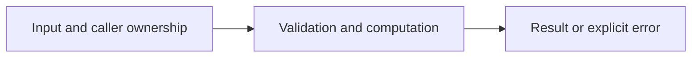

# Reader interfaces and line parsing

Difficulty: **medium**. Read [the lesson](../../../lessons/07-files-system.md) first.

## Contract

Implement SumLines(r io.Reader) (int64,error). Sum signed base-10 int64 values,
one per line, trimming whitespace and skipping blank lines. Propagate read errors.
Reject invalid values and sum overflow. Maximum line size is 1 MiB including newline;
scanner token-too-long errors are acceptable. Error results must return sum zero.

## Architecture



```text
Any io.Reader --> bounded bufio.Scanner --> parsed int64 accumulator
```

Before coding, name who owns each mutable value and resource. For concurrent code,
name each goroutine's exit condition and which sender closes each channel.

## Work

1. Read `exercise.go` and `exercise_test.go`. Keep the exported API.
2. Replace TODO panics in `exercise.go`; do not import the reference answer.
3. Add a regression case in a new `regression_test.go`; keep supplied tests intact.
4. Explain time/space complexity and the ownership or cancellation contract.

From the workspace root:

```sh
go test -count=1 -timeout=30s ./assignments/medium/04-stream-reader
go test -race -count=1 -timeout=30s ./assignments/medium/04-stream-reader
```

Tests intentionally fail until implemented. The supplied tests are acceptance examples,
not proof of correctness; review complexity and lifecycle guarantees too.
See [the explained solution](../../../solutions/medium/04-stream-reader/README.md) only after attempting it.
