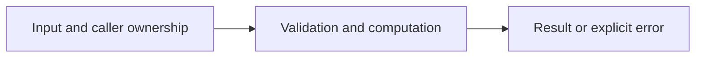

# Synchronization and race detection

Difficulty: **medium**. Read [the lesson](../../../lessons/08-concurrency.md) first.

## Contract

Implement Counter with Add(delta int64) and Value() int64. Its zero value must work.
Concurrent calls must be race free and no increments may be lost. Values in tests fit int64.
Do not copy the counter after first use. Use sync.Mutex or sync/atomic.

## Architecture



```text
Many goroutines --> synchronized Counter --> consistent numeric snapshot
```

Before coding, name who owns each mutable value and resource. For concurrent code,
name each goroutine's exit condition and which sender closes each channel.

## Work

1. Read `exercise.go` and `exercise_test.go`. Keep the exported API.
2. Replace TODO panics in `exercise.go`; do not import the reference answer.
3. Add a regression case in a new `regression_test.go`; keep supplied tests intact.
4. Explain time/space complexity and the ownership or cancellation contract.

From the workspace root:

```sh
go test -count=1 -timeout=30s ./assignments/medium/05-counter
go test -race -count=1 -timeout=30s ./assignments/medium/05-counter
```

Tests intentionally fail until implemented. The supplied tests are acceptance examples,
not proof of correctness; review complexity and lifecycle guarantees too.
See [the explained solution](../../../solutions/medium/05-counter/README.md) only after attempting it.
