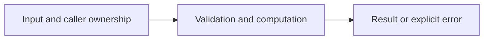

# Bounded goroutines and cancellation

Difficulty: **medium**. Read [the lesson](../../../lessons/08-concurrency.md) first.

## Contract

Implement Map(ctx context.Context, nums []int, workers int, fn func(context.Context,int)(int,error)) ([]int,error).
Use at most workers callbacks at once, preserve input order, reject workers<=0 and nil fn.
On callback error or cancellation return nil,error and cancel remaining work. Join started
workers before returning. A callback must cooperate with ctx and must not panic; otherwise
no implementation can promise prompt shutdown. Empty input is valid. Do not mutate nums.

## Architecture



```text
Producer --> jobs channel --> N workers --> disjoint result slots; derived context cancels all
```

Before coding, name who owns each mutable value and resource. For concurrent code,
name each goroutine's exit condition and which sender closes each channel.

## Work

1. Read `exercise.go` and `exercise_test.go`. Keep the exported API.
2. Replace TODO panics in `exercise.go`; do not import the reference answer.
3. Add a regression case in a new `regression_test.go`; keep supplied tests intact.
4. Explain time/space complexity and the ownership or cancellation contract.

From the workspace root:

```sh
go test -count=1 -timeout=30s ./assignments/medium/06-worker-pool
go test -race -count=1 -timeout=30s ./assignments/medium/06-worker-pool
```

Tests intentionally fail until implemented. The supplied tests are acceptance examples,
not proof of correctness; review complexity and lifecycle guarantees too.
See [the explained solution](../../../solutions/medium/06-worker-pool/README.md) only after attempting it.
