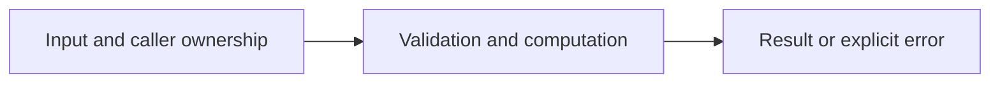

# HTTP routes and JSON boundaries

Difficulty: **medium**. Read [the lesson](../../../lessons/10-http.md) first.

## Contract

Implement NewHandler() http.Handler. POST /sum accepts exactly one JSON object with
required integer fields a and b, no unknown fields, and responds {"sum": a+b} with JSON
content type and status 200. Use int64 values and reject addition overflow.
Reject malformed/missing/null/trailing fields with 400. Limit body to 1024 bytes and return
413 if exceeded. GET /health returns 200. Unknown paths return 404; wrong method on known
paths returns 405 with Allow. Validation error bodies may use http.Error text.

## Architecture



```text
HTTP request --> route/method gate --> bounded strict decoder --> calculation --> JSON response
```

Before coding, name who owns each mutable value and resource. For concurrent code,
name each goroutine's exit condition and which sender closes each channel.

## Work

1. Read `exercise.go` and `exercise_test.go`. Keep the exported API.
2. Replace TODO panics in `exercise.go`; do not import the reference answer.
3. Add a regression case in a new `regression_test.go`; keep supplied tests intact.
4. Explain time/space complexity and the ownership or cancellation contract.

From the workspace root:

```sh
go test -count=1 -timeout=30s ./assignments/medium/07-http-handler
go test -race -count=1 -timeout=30s ./assignments/medium/07-http-handler
```

Tests intentionally fail until implemented. The supplied tests are acceptance examples,
not proof of correctness; review complexity and lifecycle guarantees too.
See [the explained solution](../../../solutions/medium/07-http-handler/README.md) only after attempting it.
