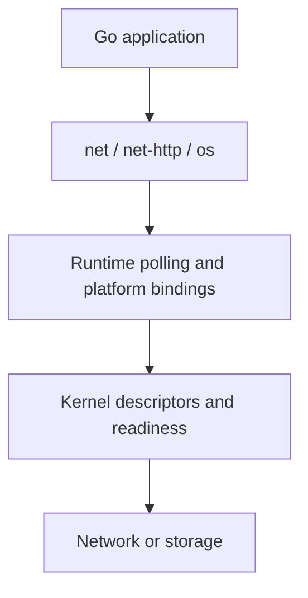

# System and network calls: from Go to the kernel

| Operation | Go interface | Conceptual OS boundary |
| --- | --- | --- |
| Open/read/write/close file | os.Open/OpenFile, File.Read/Write/Close | File descriptors/handles and filesystem calls |
| Metadata/directories | os.Stat/ReadDir/MkdirAll | Filesystem metadata operations |
| Start and wait for process | os/exec.CommandContext, Cmd.Run/Wait | Process creation and exit status |
| Receive termination signal | os/signal.NotifyContext | Signal delivery translated into context cancellation |
| Resolve hostname | net.Resolver.LookupHost(ctx,name) | Resolver may use Go DNS or platform facilities |
| Bind/listen/accept | net.Listen, Listener.Accept | Listening socket, kernel accept queue, connected socket |
| Connect with deadline | net.Dialer.DialContext | DNS/connect with runtime and platform support |
| Send/receive stream | net.Conn.Read/Write | TCP stream; partial I/O; runtime readiness integration |
| Send/receive datagram | net.ListenPacket, PacketConn.ReadFrom/WriteTo | UDP message boundary, possible loss/reorder |
| Local process socket | net.Listen("unix",filename) | Unix-domain socket on supported systems |
| TLS | crypto/tls, net/http.Server.ServeTLS | Cryptographic protocol layered over a Conn |
| Raw syscall | syscall / platform APIs | OS-specific calls; portability and lifecycle are yours |

This is a conceptual map, not a promise that one Go method equals one syscall. Buffering,
platform DNS choices, connection reuse, readiness and runtime implementation change the
actual sequence. On Linux use strace; on macOS use suitable permitted tracing tools such
as dtruss or Instruments. Tracing often needs OS privileges and may be unavailable in a
sandbox. The examples do not require these tools or raw syscall code.

Practice path: original hello.go -> examples/tcp-echo + tcp-client -> examples/udp ->
examples/dns -> hard/03-tcp-frames -> hard/05-https. The system example uses a temporary
file, os.Stat, io operations and a bounded child process (`go version`).

For every resource write down: creator, close owner, deadline, partial-I/O behavior,
error policy, and shutdown unblocking. A listener close does not close old Conns; a
context cancel does not interrupt an arbitrary Reader; a buffered Flush does not imply
stable storage. Those distinctions prevent many interview repair bugs.
