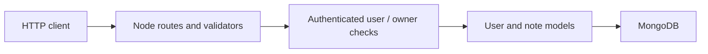

# Barstool Sports: existing API features and tests

Source and authoritative requirements: [original README](https://github.com/BarstoolSports/backend-challenge#project-requirements).
Company-owned Node.js repository; this is extension and test work rather than a compact Go bug hunt.

Tasks include database-aware health status, user-update authorization tests, a notes module,
creation and listing routes, and validation for pagination, sorting and filtering. Use the
upstream Node version and MongoDB setup described in its README rather than assuming the
local Go toolchain is sufficient.

Curriculum test suggestions: database disconnected status, cross-user denial, empty notes,
invalid pagination, deterministic sort/filter output and note ownership on creation.
Read existing tests before changing the route structure. A personal Go port is a separate
learning extension and not the original company task. No upstream dependencies were installed,
and neither tests nor source line measurements were available during setup.
