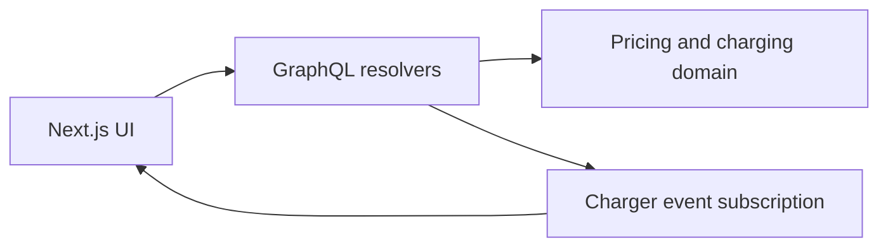

# DejaBlue: pricing, algorithms, and concurrency in Go

Source and authoritative tasks: [original README](https://github.com/deja-blue/software-interview#exercises).
Company-owned Go/TypeScript full-stack take-home, aimed at a longer exercise than a small repair task.

The tasks add charging controls, time-dependent tariffs, selection of an economical charging
window, live charger-state updates and UI completion. The backend work spans pricing rules,
algorithm design and GraphQL streaming. The source supplies exact tariff intervals and
project-specific APIs; read them rather than guessing policy from this summary.

Curriculum tests should focus on tariff boundaries/weekends, cheapest-window edge cases,
subscription cancellation and event ordering. These are study suggestions, not official answers.
The README asks candidates not to fork; the clone script only makes a local copy. It references
Figma for UI details, so some frontend context may require access beyond GitHub. No upstream
setup, generated-code commands or tests were executed during curriculum setup.
