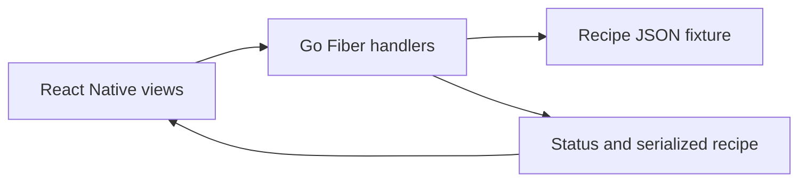

# Dr.Fit: Go repository repair and UI integration

Source and authoritative questions: [original README](https://github.com/YordanBahov-bg/dr-fit-hiring-test#readme).
Personal author account; README describes an employer hiring task, not independently verified company ownership.

The reports concern recipe-list crashes, inconsistent ingredient data and ambiguous responses
for missing recipe IDs. The feature work adds recipe search and a detail screen. Preserve
`backend/data/recipes.json` and make code handle its varied data. Read upstream rules and
setup before starting; its time target is short, while first-time environment setup may take longer.

Suggested study tests: missing-ID status, ingredient shape variations, empty/search results
and stable list/detail rendering. These are curriculum suggestions, not an official grading suite.
Read frontend call sites as well as the backend before changing the wire shape.
After cloning inspect `backend`, `frontend`, the data file and upstream README. The live
backend is outside the standard-library-only examples because it uses Fiber.
No upstream execution or source line measurement was possible during setup.
