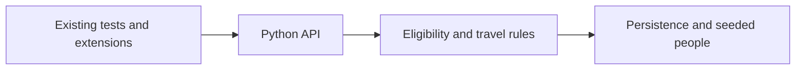

# Noyo: understand and extend an existing application

Source and authoritative problems: [original README](https://github.com/noyo-technologies/backend-coding-challenge#readme).
Company-owned Python repository. It explicitly says bugs are not intentionally planted;
this is existing-code feature/debugging/test practice rather than a fixed-count bug hunt.

The application models insurance eligibility for traveling salespeople. Follow the
README's Take Home Problem 1 and later live-extension section. Understand current rules
and fixtures before extending coverage, then improve incomplete tests around boundaries.
The original source is required to perform the exact task; this guide does not invent live questions.

Use upstream Docker/Python setup and record its test baseline. Practice identifying which
layer owns a rule, writing a regression, and explaining how your extension preserves prior
behavior. The README asks candidates to avoid public forks/submissions against the source;
local cloning for study is separate from submitting work. No message or submission is sent.
No upstream tests or source size checks were run during curriculum setup.
