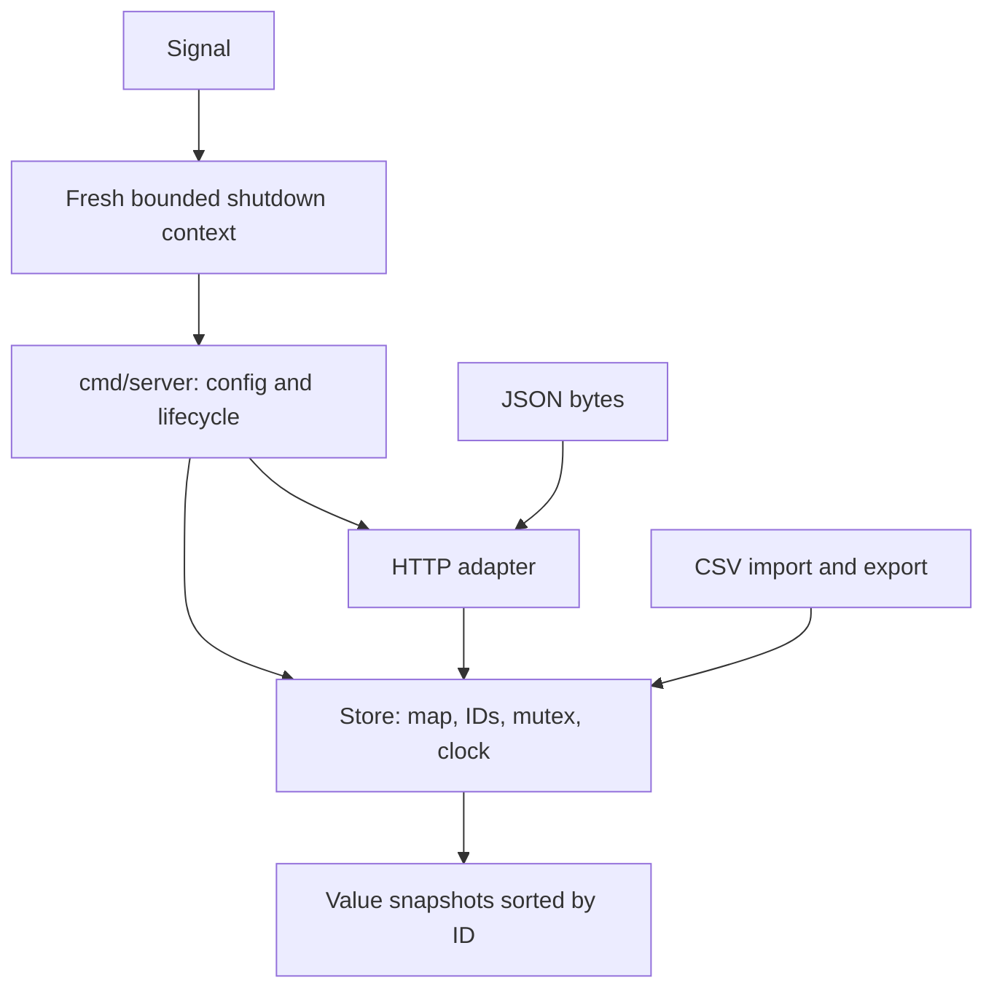

# Repair Shop: compact Go repository interview

**Original teaching exercise, not a company question.** Difficulty: medium -> hard.
Timebox: 75–90 minutes after the roadmap. The starter contains eight intentional defects.
Production source is 514 lines across store.go, csv.go, http.go and
cmd/server/main.go (gofmt physical lines, including comments/blanks; tests excluded).
See `python3 scripts/audit-curriculum.py` for the current exact count.

You join a team maintaining an in-memory task API. The service compiles but users report:

1. Whitespace-only and overly long task titles can be saved.
2. Fetching a missing task does not produce a missing-resource result.
3. Marking a task incomplete does not reopen it.
4. Listing an offset beyond the end can crash.
5. Pages and exports have the wrong ordering.
6. A failed CSV import can leave some records saved.
7. Export reports success even when the output writer fails.
8. Requests containing an extra JSON value can be accepted.

## Architecture



`store.go` owns validation/state. `http.go` maps HTTP to domain calls. `csv.go` handles
batch boundaries and serialization. The command wires configuration, the listener and
shutdown. HTTP handlers can run concurrently; do not remove locking to make a test pass.
Store values and snapshots must not expose mutable internal state.

## Required behavior

- Titles are trimmed, nonblank and at most 120 Unicode code points. IDs start at 1 and increase without reuse; failed operations/imports do not consume IDs. ID overflow is outside this lab's scope.
- Missing Get/Complete/Delete returns ErrNotFound. Complete accepts both true and false.
- List uses ascending ID order. offset>=length returns a non-nil empty page. offset<0, limit<1 or limit>100 returns ErrPage. Snapshot and export are also ascending.
- Stats reports a consistent total/completed/pending snapshot. Search trims a nonblank query of at most 120 runes and matches title substrings case-insensitively, in ascending ID order.
- ImportCSV requires header title,done, valid titles, and exact true/false values. Validate the entire batch before one locked commit. On any error return 0,error and preserve all state/IDs.
- ExportCSV writes header id,title,done, preserves quote-aware CSV formatting, checks Flush errors and releases the lock before writer I/O.
- HTTP JSON bodies are <=1024 bytes, strict about unknown fields and presence, and contain exactly one JSON value. Duplicates inherit encoding/json behavior. Missing/null fields fail validation. Errors return 400, 404, 405 with Allow, or 413 as appropriate. Success is JSON with the appropriate content type; creation returns 201 with Location, delete returns 204.
- The store stays race free. Use the supplied clock only under its owner lock; injected clocks must not reenter the store. Memory is intentionally unbounded: this is a small in-memory teaching service, not a production database.

## Run and repair

```sh
# From workspace root:
go test -count=1 -timeout=30s ./interviews/repair-shop
go test -run TestImportAtomicity ./interviews/repair-shop
go test -race -count=1 -timeout=30s ./interviews/repair-shop
go run ./interviews/repair-shop/cmd/server
# In another terminal:
curl http://127.0.0.1:8080/health
curl -X POST -H 'Content-Type: application/json' -d '{"title":"Learn Go"}' http://127.0.0.1:8080/tasks
```

Tests initially fail, and pagination can panic after you repair ordering. Work on focused
tests first. Keep the API and supplied acceptance tests; add your regressions in a new
regression_test.go. Explain each fix and update an architecture diagram if ownership changes.
The command serves local HTTP; the separate HTTPS example covers TLS configuration.

Routes: GET /health, GET/POST /tasks, GET/PATCH/DELETE /tasks/{id}, GET /export,
GET /stats and GET /search?q=term. There is no HTTP import route; ImportCSV is a library
operation tested directly. No persistence or authorization is claimed in this lab.

Try it before reading [the explained solution](../../solutions/interviews/repair-shop/README.md).
