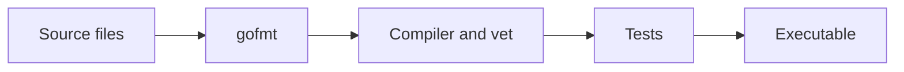

# Setup and your first feedback loop


Go compiles source into executables. A package groups files in one directory; a module groups packages under an import-path prefix. A `main` package with `func main()` is an executable. Other packages expose reusable functions. Names beginning with a capital letter are exported outside the package. Imports are file-local, so importing fmt in one file does not make it available in another.

Install a current Go toolchain from [go.dev/dl](https://go.dev/dl/) and an editor with the Go extension or gopls. This curriculum targets Go 1.22 language/library APIs or later. Check `go version`; the existing module name `example/hello` is retained. No third-party dependencies are needed for the local curriculum. Git and network access are needed only for upstream interview clones; some upstream projects additionally need Node, Python, or Docker.

```sh
go version
go env GOMOD
go run ./examples/basics
go test ./solutions/easy/01-statistics
make test
```

Read the root README before using `go test ./...`: all exercise tests are deliberately active, so unsolved assignments fail. `make test` selects completed examples and reference solutions. To work on one exercise use `make check ID=easy/01-statistics`. If make is unavailable, use the corresponding go test command shown in each assignment.



`go run` builds into a temporary location and executes. `go build ./examples/basics` creates an executable. `go test` builds test binaries and executes functions named TestXxx in `_test.go` files. `go fmt` and `gofmt` format source; let the tool decide indentation. `go vet` identifies suspicious constructs. `go mod tidy` updates dependencies; it should not be necessary here.

Keep `hello.go`: it is your original single-connection TCP experiment. It waits for a client on port 3000, so it is not the first lesson's hello-world. Revisit it after networking and compare it to the multi-connection echo server. Never start learning by memorizing all standard-library names; learn one API while solving a concrete problem.

Completion gate: run the basics example, deliberately introduce a syntax error and read its compiler message, restore it, then explain the difference between a module, package, source file and executable. Create a `scratch/hello/main.go` only when you want your own experiment; do not add a second main function to the root package.
