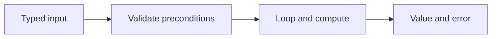

# Values, control flow, and functions


A variable has a static type. `var count int` starts at zero; `count := 3` declares with inferred type inside a function. Other zero values include false, "", nil slices, nil maps and nil pointers. Constants use `const`. Prefer descriptive short names in small scopes. Go has no implicit int-to-float or int-to-int64 conversion; convert deliberately and consider overflow.

```go
func Average(a, b int) float64 {
    return float64(a+b) / 2 // assumes a+b fits in int
}
func Divide(a, b float64) (float64, error) {
    if b == 0 { return 0, fmt.Errorf("division by zero") }
    return a / b, nil
}
```

Integers truncate on integer division. `int` size depends on the architecture; use int64 for a fixed numeric domain. Float64 is approximate and is unsuitable for exact cents; use integer cents or a deliberately chosen decimal representation. `byte` aliases uint8; `rune` aliases int32. Booleans are not implicitly converted from integers or strings. Go has no ternary expression.

Use `if`, `switch` and `for`. `for` supports a three-part loop, a condition-only loop, an infinite loop and `range`. `range` over a slice gives index and value; the value is a copy. Use `_` to discard an unused result. A switch case does not fall through by default. `break` exits the innermost loop/switch; `continue` begins the next loop iteration. Prefer simple explicit branches before clever expressions.

```go
sum := 0
for _, n := range []int{2, 4, 6} { sum += n }
switch {
case sum < 0: fmt.Println("negative")
case sum == 0: fmt.Println("zero")
default: fmt.Println("positive")
}
```

Functions can return several values; `(value, error)` is a central Go convention. Parameters are passed by value, including pointers and slice descriptors. Variadic `func Sum(nums ...int)` accepts individual numbers or `Sum(slice...)`. Closures capture surrounding variables; captured mutable state can create races if shared between goroutines. Recursion needs a base case and consumes stack space; an explicit stack is useful for very deep traversals.



Run `go run ./examples/basics`. Solve [statistics](../assignments/easy/01-statistics/README.md). Before running tests predict the result for all-negative numbers, empty input and [1,2]. Completion gate: explain zero values, declaration versus assignment, integer division, value copying, and why errors are returned explicitly. Learn the core language through the official [Tour of Go](https://go.dev/tour/).
