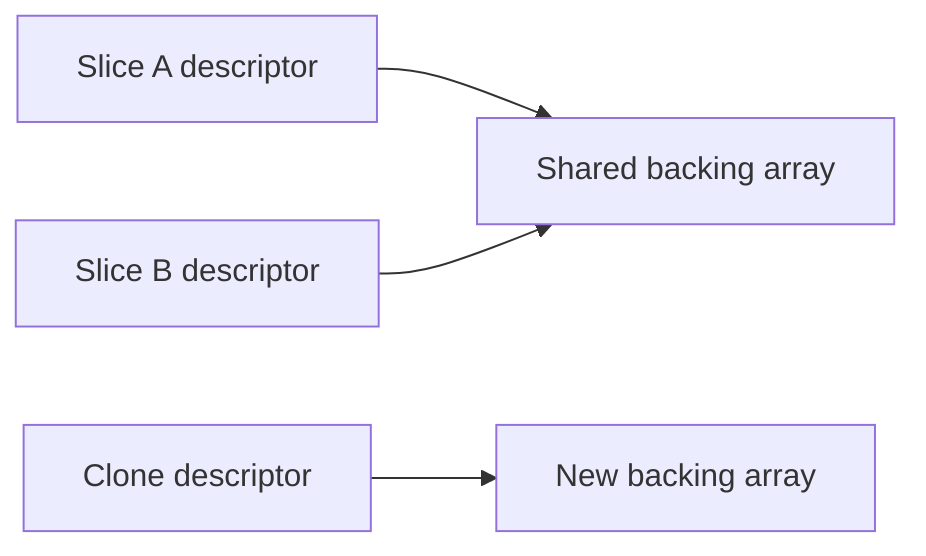

# Arrays, slices, maps, and memory ownership


An array `[3]int` owns exactly three elements and its length is part of its type. Assigning it copies its values. A slice `[]int` is a small descriptor referring to an array, with length and capacity. Assigning a slice copies that descriptor and shares the backing storage. `make([]int, length, capacity)` allocates initialized elements; `make([]int, 0, capacity)` reserves room without creating logical elements.

```go
values := []int{1, 2, 3, 4}
view := values[1:3] // [2,3], shares storage
view[0] = 99       // values is now [1,99,3,4]
owned := slices.Clone(view)
owned[0] = 2      // values stays unchanged
values = append(values, 5) // always keep append's result
```

A slice expression `s[low:high]` uses half-open bounds and indexes bytes if s is a string. Out-of-range bounds panic. append may reuse storage or allocate, so code must not depend on a capacity accident. `copy(dst,src)` handles overlap and copies min(len(dst),len(src)) values. `slices.Clone` is shallow: nested slices, maps or pointers still share their referents. Clear pointer-containing slots before shrinking a long-lived container to avoid retaining objects. `s[:len(s):len(s)]` limits capacity, preventing append through that view from overwriting following elements; it does not stop element mutation.



Maps associate comparable keys with values: `map[string]int`. Initialize before insertion. `value, ok := m[key]` distinguishes absence from an explicitly stored zero. `delete(m,key)` is safe for absent keys. A nil map can be read and deleted from, but inserting panics. Map values are not addressable: retrieve, modify and assign a struct value back, or intentionally store pointers. Ordinary maps are not safe for concurrent read/write or write/write; protect the ownership boundary.

Sets use `map[T]struct{}` for comparable T. Map iteration order is unspecified, so sort keys for deterministic output. Arrays and structs can be comparable when all their fields are; slices, maps and functions cannot be ordinary map keys. `any` does not promise comparability at runtime. nil and empty slices have len 0, but JSON usually encodes them as null and [] respectively. APIs should state whether that distinction matters.

Use `slices.Sort`, `slices.SortFunc`, `slices.BinarySearch`, `slices.Contains`, `slices.Equal`, `slices.Delete`, `slices.Compact`, `maps.Clone` and `maps.Equal`. Compact removes adjacent duplicates, so sort first when you want all duplicates removed. Delete modifies the slice's backing storage and returns a shorter slice; keep its result. BinarySearch requires sorted input. See the [slices documentation](https://pkg.go.dev/slices) and [STL mapping](../docs/stl-to-go.md).

Solve [rotation](../assignments/easy/03-slice-rotation/README.md) and [maps/sets](../assignments/easy/04-maps-sets/README.md). Completion gate: draw backing arrays for slicing, append with spare capacity and append without spare capacity. Explain why a hash set does not replace an ordered std::set when range queries matter.
