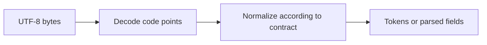

# Strings, bytes, Unicode, and useful APIs


Go strings are immutable byte sequences, conventionally UTF-8. `len("é")` counts two bytes; `utf8.RuneCountInString("é")` counts one rune. `for i,r := range text` decodes runes and reports byte offsets. A rune is a code point, not necessarily a visible grapheme: an emoji sequence or a letter plus combining mark can contain several runes. []rune-based algorithms solve code-point problems, not every human-text problem.

```go
text := "café"
fmt.Println(len(text))                  // 5 bytes
fmt.Println(utf8.RuneCountInString(text)) // 4 runes
fmt.Println(text[:3])                   // "caf", byte slice
runes := []rune(text)
fmt.Println(string(runes[:3]))          // "caf", rune slice
```

Useful APIs: `strings.Fields` for whitespace tokens, `Split`/`SplitN` for a delimiter, `Cut` for a single boundary, `TrimSpace`, `Trim` for a set of runes, `TrimPrefix`/`TrimSuffix` for exact text, `Contains`, `HasPrefix`, `Index`, `ReplaceAll`, `ToLower`, `EqualFold`, `Join`, and `strings.Builder` for repeated construction. `strings.Trim(s,"abc")` removes any a/b/c at either end, not the substring "abc". `strconv.Atoi`, `ParseInt`, `ParseFloat`, `Itoa`, and `FormatInt` convert strings and numbers; check their errors.

```go
name, value, ok := strings.Cut("port=8443", "=")
if !ok { return fmt.Errorf("missing separator") }
port, err := strconv.Atoi(value)
if err != nil { return fmt.Errorf("invalid %s: %w", name, err) }
```

`bytes` supplies analogous helpers for []byte. Convert only when useful: `[]byte(s)` gives mutable bytes; `string(b)` gives immutable text semantics. Use `unicode.IsLetter`, `IsDigit`, `IsPunct` and `IsSpace` for classification. Regular expressions in `regexp` are useful for structured patterns; compile a reused expression once. Do not parse CSV or nested JSON with a regex. `fmt.Sprintf` is readable for formatting, but benchmark before optimizing it away.



See [the JavaScript/C++ API cheat sheet](../docs/stdlib-cheatsheet.md) for equivalents to slice, JSON.parse, response.json and array operations. Go has no built-in map/filter array methods; explicit loops usually make allocation and errors clearer. JavaScript string slicing uses UTF-16 code units while Go slicing uses bytes, so identical indexes need not mean identical characters.

Solve [Unicode words](../assignments/easy/02-unicode-words/README.md). Completion gate: explain why reversing bytes corrupts UTF-8, why reversing runes still may break grapheme clusters, and what normalization policy your program promises. This curriculum does not provide full Unicode normalization because the standard library has no comprehensive normalization package.
