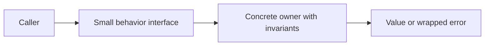

# Pointers, structs, interfaces, errors, and generics


A struct groups fields; methods attach behavior to a named type. Use a pointer receiver when a method mutates the value, avoids copying a large struct, or needs consistent receiver semantics. Go passes a pointer by value, so changing the pointee affects the caller while reassigning the local pointer does not. `&x` takes an address; `*p` dereferences it. nil pointers must be handled according to the API contract.

Interfaces describe behavior and are satisfied implicitly. A small consumer-defined interface is easier to implement and test than a huge service interface. `io.Reader` needs only `Read([]byte)(int,error)`. Prefer accepting an interface when the consumer genuinely needs interchangeable implementations; do not create an interface for every concrete type. Embedding promotes methods and supports composition; Go has no class inheritance.

```go
type Reader interface { Read([]byte) (int, error) }
type Account struct { cents int64 }
func (a *Account) Balance() int64 { return a.cents }
```

An interface contains a dynamic type and dynamic value. An error interface holding a typed nil pointer is not nil. Return plain nil on success rather than a typed nil error. Use `errors.New` for sentinel errors, `fmt.Errorf("load config: %w",err)` to wrap, `errors.Is` to recognize a wrapped sentinel and `errors.As` for an error type. Avoid comparing error text. Use `defer` for cleanup immediately after successful acquisition; deferred calls run on normal return and panic unwinding. Arguments to a deferred call are evaluated when defer executes. Deferred cleanup in a long-running loop waits until the containing function returns; factor each iteration into a function.

```go
file, err := os.Open(filename)
if err != nil { return fmt.Errorf("open: %w", err) }
defer file.Close()
```

Return errors for expected failures. panic is for violated program invariants or impossible states, not bad user input. recover only works in a deferred function in the panicking goroutine; use it at deliberate process/request boundaries, not to conceal defects. A deferred Close on a writable file may itself fail; decide how to report flush/close errors. Do not use log.Fatal in library functions: it exits the process and skips defers.

Generics parameterize types and functions: `type Stack[T any] struct { items []T }`. `any` is the empty interface; `comparable` allows equality and map-key operations subject to dynamic comparability caveats for interface values. Constraints can use type sets such as `~int | ~int64`. Choose concrete types first; use generics when one algorithm genuinely applies to several types. Reflection inspects runtime types but loses compile-time guarantees; unsafe can violate memory safety and is unnecessary for this curriculum.



Solve [account](../assignments/easy/05-account/README.md). Completion gate: explain value versus pointer receivers, interface satisfaction, typed nil, defer evaluation, and errors.Is versus string matching. Then revisit these concepts in the reader and generic-container assignments.
