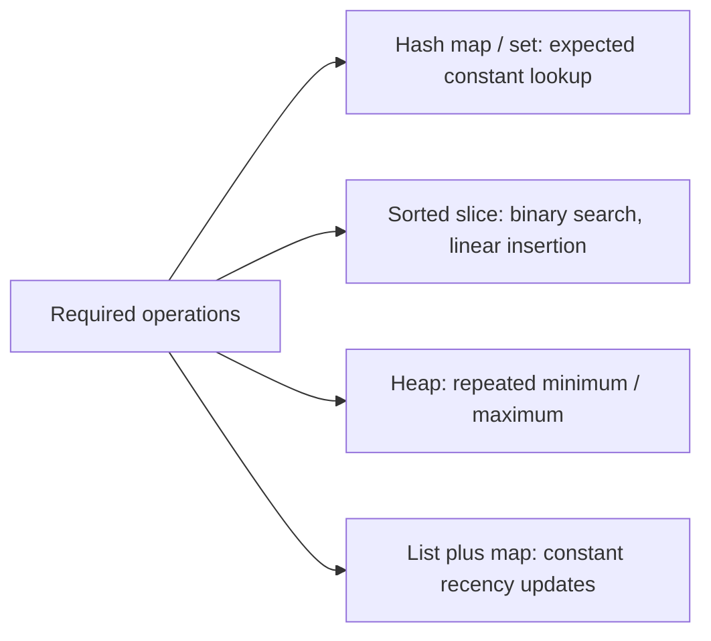

# Data structures, algorithms, and C++ STL equivalents

Choose a structure from its operations, ordering needs and ownership. A Go slice is the usual std::vector equivalent. Maps provide hash lookup; they do not provide ordered iteration. A set is a map with empty values. Stack and queue operations are straightforward over slices, but a queue that shifts every element on each Pop has O(n) removals. Use a head index or ring buffer and clear removed pointers.

`container/heap` supplies heap algorithms against an interface you implement: Len, Less, Swap, Push(any), Pop() any. Less determines priority; a min-heap has the smallest element at the root. Call heap.Push/Pop, not your adapter methods directly. `container/list` is a doubly linked list with node handles, useful for LRU. Its Value is any and requires assertions. For most sequential traversal a slice is simpler and more cache-friendly than a linked list.

Read [the detailed STL mapping](../docs/stl-to-go.md), including std::array, vector, deque, list, stack, queue, priority_queue, map, set, unordered_map, unordered_set, pair and multimap/multiset. There is no standard ordered tree map/set or general deque. A sorted slice plus BinarySearch is often enough for small or read-heavy data. A balanced tree is a separate implementation or dependency when dynamic ordered operations dominate; pretending map gives std::map guarantees is incorrect.

Complexity describes growth, not wall-clock speed. Distinguish worst-case, expected and amortized costs. append is amortized O(1); one growth may copy O(n) elements. Hash lookup is conventionally expected O(1), not a universal worst-case guarantee. Sorting costs O(n log n). Binary search costs O(log n) only on sorted data. Explain both time and extra memory, including result buffers, queues, recursion stacks, and duplicate heap entries.

Graph adjacency lists use `map[string][]string` or slices indexed by integers. BFS finds shortest unweighted paths using a FIFO frontier. DFS explores depth-first and supports reachability, cycle reasoning and topological ordering, but not general shortest paths. Dijkstra handles nonnegative weights with a priority queue. Negative edges break its greedy argument. Trees are graphs with extra invariants; a binary search tree needs a balance policy to avoid degrading to a linked list.

Solve medium [containers](../assignments/medium/01-containers/README.md), [top K](../assignments/medium/02-top-k/README.md), and [BFS](../assignments/medium/03-bfs/README.md). Return later for hard [LRU](../assignments/hard/01-lru/README.md) and [Dijkstra](../assignments/hard/07-dijkstra/README.md). Completion gate: choose a structure for a leaderboard, a work queue, a deduplication index and an expiring cache, explaining costs and order guarantees. Optional algorithm extensions should include your own tests before you call them complete.
