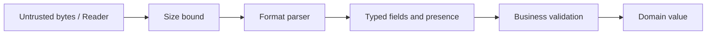

# JSON, CSV, and serialization boundaries


JSON parsing has three responsibilities: syntax, type conversion and business validation. `json.Unmarshal(data,&target)` parses bytes; `json.NewDecoder(reader).Decode(&target)` reads a stream. `json.Marshal(value)` returns bytes; `json.NewEncoder(writer).Encode(value)` writes JSON plus a newline. The target must be a non-nil pointer. Only exported struct fields are encoded; tags such as `json:"name"` define wire names. `omitempty` may omit meaningful zero values, so use it deliberately.

```go
type Profile struct {
    Name string `json:"name"`
    Age  int    `json:"age"`
}
var p Profile
if err := json.Unmarshal(data, &p); err != nil { return err }
if strings.TrimSpace(p.Name) == "" { return errors.New("name required") }
```

Unknown fields are ignored by default. Use Decoder.DisallowUnknownFields for strict request contracts. A decoder reads one JSON value at a time; after the expected value, decode once more and require io.EOF when trailing content is forbidden. Fields decoded into pointers distinguish zero from missing/null; additional machinery is necessary when missing and explicit null must themselves differ. Duplicate keys generally follow last-value/merge behavior; this curriculum's basic decoders do not reject them. For untrusted input, bound bytes before decoding.

Unstructured `map[string]any` JSON numbers decode as float64 by default and can lose integer precision. Decoder.UseNumber gives json.Number for deferred conversion. Prefer typed structs when a schema is known. json.RawMessage defers decoding one subtree. `[]byte` encodes as base64 JSON text; time.Time has its own JSON encoding. nil slices/maps and empty slices/maps can have different JSON representations. Check encoding errors too: unsupported values, nonfinite floats and cycles can fail.



CSV has quoting and multiline records; never split it on commas. `csv.NewReader(r).Read()` reads one record and ReadAll reads all. FieldsPerRecord enforces width; ReuseRecord may reuse the returned slice, so do not enable it when handing records to other goroutines unless you copy them. `csv.NewWriter(w)` buffers output: call Flush and check Error afterward. A successful Write does not guarantee the underlying writer succeeded during flush.

```go
writer := csv.NewWriter(out)
if err := writer.Write([]string{"name", "score"}); err != nil { return err }
writer.Flush()
return writer.Error()
```

Solve easy [JSON](../assignments/easy/06-json/README.md) and [CSV](../assignments/easy/07-csv/README.md). Run `go run ./examples/parsing`. Completion gate: explain why `Decode` needs `&p`, why age zero is valid but missing age is not, and why a quoted comma changes the parsing strategy. API references: [encoding/json](https://pkg.go.dev/encoding/json), [encoding/csv](https://pkg.go.dev/encoding/csv).
