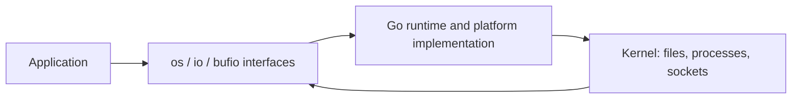

# Files, processes, and system calls


Go's portable APIs eventually interact with the operating system. Opening a file asks the kernel for a file descriptor/handle; reading and writing transfer bytes; closing releases the resource. `os.Open`, `OpenFile`, `ReadFile`, `WriteFile`, `Stat`, `ReadDir`, `MkdirAll`, `Rename` and `Remove` cover common operations. `filepath.Join` builds platform-appropriate paths; path.Join is for slash-separated logical paths such as URLs. Environment variables use os.LookupEnv when absence must be distinguished from an empty value.

```go
file, err := os.Open(filename)
if err != nil { return err }
defer file.Close()
reader := bufio.NewScanner(file)
for reader.Scan() { fmt.Println(reader.Text()) }
return reader.Err()
```

`io.Reader`/`io.Writer` let files, strings, network connections and buffers share algorithms. A Read can return n>0 together with an error: process those bytes before the error. io.ReadFull is for exact-size data; io.Copy streams between interfaces; io.LimitReader bounds consumption. ReadAll is appropriate only when total size is known or capped. Scanner has a default token bound; configure Buffer and always check Err. bufio.Writer needs Flush and error handling. The caller that opens a resource normally owns closing it; state any transfer explicitly.



Use `exec.CommandContext(ctx, executable, args...)` to run another process. Pass arguments separately rather than constructing a shell string from user input. `Output` captures stdout; `CombinedOutput` also captures stderr. For unbounded output, stream to a writer. A process cancellation policy for child process groups can be platform-specific; CommandContext does not automatically solve every descendant-process lifecycle. `signal.NotifyContext` translates Ctrl+C into cancellation; call its stop function to release signal handling.

Raw system calls are platform-specific and lower-level than net/os. The standard syscall package exists but is constrained; new code often uses platform packages in golang.org/x/sys when a portable API cannot express a feature. That is outside this standard-library-only workspace. Learn descriptors, blocking/nonblocking I/O, readiness and errno conceptually before reaching for raw syscalls. DNS lookup, socket accept/connect, TCP read/write and file open are system/network calls even when reached through high-level Go APIs. See [system-call notes](../docs/system-network-calls.md).

File replacement with a temp file and Rename can prevent readers from seeing a partially written file on supported same-filesystem paths, but crash durability requires careful Sync and directory handling with OS-specific guarantees. Do not call a simple WriteFile an atomic transaction. In tests use t.TempDir and injected readers, not fixed paths in your home directory.

Solve [SumLines](../assignments/medium/04-stream-reader/README.md), then run `go run ./examples/system`. Completion gate: explain who closes each handle, how read errors propagate, the difference between buffered and durable writes, and why a portable API is usually preferable to a raw syscall.
