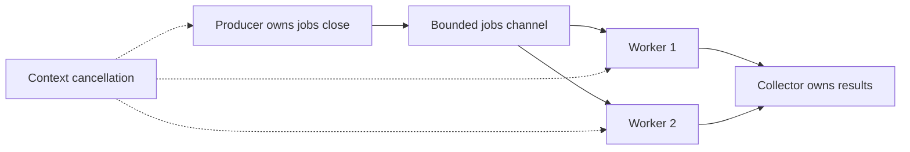

# Goroutines, channels, locks, and bounded work

Concurrency means coordinating overlapping tasks; parallelism means executing tasks simultaneously. A goroutine is a lightweight task scheduled by the Go runtime onto OS threads. It is not one dedicated OS thread. The scheduler, GOMAXPROCS, blocking I/O and available CPU influence actual parallelism. Starting `go f()` does not wait for f; main returning exits the program even if other goroutines remain.

Shared-memory coordination uses sync.Mutex/RWMutex or atomics. Protect every access to an invariant with the same synchronization policy, including reads. A mutex does not become safe to copy after use. Atomics are useful for independent counters, but several atomic fields do not automatically make a multi-field transaction consistent. sync.WaitGroup joins work: call Add before launching, defer Done inside the goroutine, and Wait at the owner. WaitGroup does not protect a shared map or slice append.

Channels transfer values and coordinate ownership. Unbuffered send waits for a receiver; buffered send waits once capacity is full. A nil channel blocks forever on send/receive. Receiving from a closed channel yields remaining buffered values then zero,false. Sending to a closed channel or closing twice panics. The producer/owner closes a channel; receivers usually do not. Multiple senders need a coordinator that waits for all before closing. Channel direction types document roles: chan<- T and <-chan T.

Use select to wait on multiple channel operations and cancellation. select chooses a ready case without guaranteeing priority for cancellation, so check ctx.Err when strict phase boundaries matter. Channels are not inherently better than locks: use a mutex for a compact shared-state invariant, channels for work transfer and lifecycle. Avoid holding a lock during network calls or callbacks. Establish a lock order when more than one lock is needed.

A worker pool bounds resource use; one goroutine per item is dangerous for huge input. Backpressure means producers wait when downstream is full. Every goroutine needs an exit condition, every channel needs a close owner, and every blocking operation needs a cancellation/unblock story. A time.Sleep is not synchronization. Sending pointers/slices through a channel copies their descriptors, not their data; state who may mutate them after transfer.

Run `go run ./examples/concurrency`; solve [counter](../assignments/medium/05-counter/README.md) and [worker pool](../assignments/medium/06-worker-pool/README.md). Run their tests with -race. The race detector reports executed unsynchronized accesses; it does not prove absence of races or detect every deadlock. Completion gate: draw a happens-before explanation for your result publication and explain how every worker stops. Read [the Go memory model](https://go.dev/ref/mem) after building intuition.
