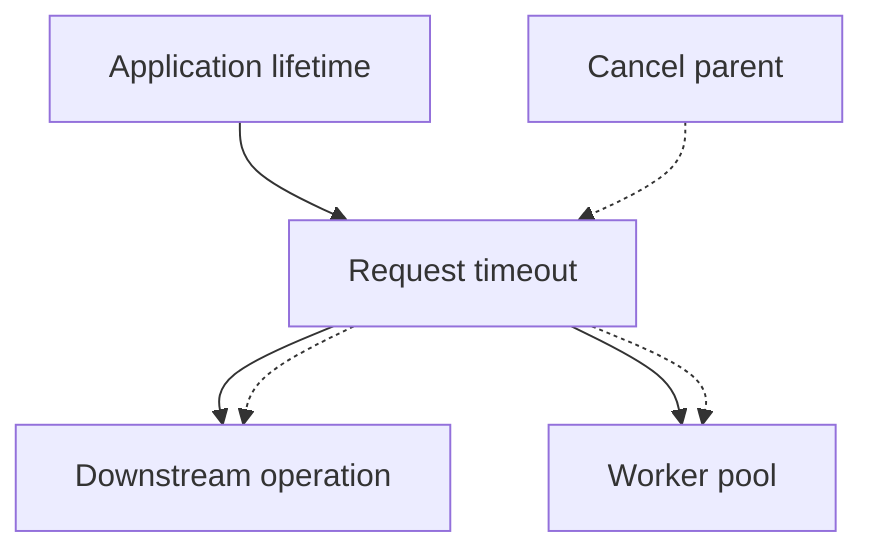

# Context, deadlines, cancellation, and time


Context carries cancellation, deadlines and request-scoped metadata across API boundaries. Pass it explicitly as the first parameter. Do not store a request context in a long-lived service. context.Background is a root; WithCancel, WithTimeout and WithDeadline derive children. Always call the returned cancel function to release associated resources, even if work finishes early.

```go
ctx, cancel := context.WithTimeout(context.Background(), 2*time.Second)
defer cancel()
req, err := http.NewRequestWithContext(ctx, http.MethodGet, url, nil)
```

Cancellation is a signal, not a forced kill. A function must select on Done, inspect Err or invoke a context-aware API. A generic io.Reader blocked inside Read cannot be canceled merely because a context changed: the owner must close/unblock the reader or use a transport with deadlines. A net.Conn can use SetDeadline; a request can use NewRequestWithContext. Use errors.Is(err,context.Canceled/DeadlineExceeded) through wrapped errors. Keep ownership clear: cancellation does not automatically close every object stored in a struct.



A timeout bounds a duration; a deadline is an absolute time. time.Duration is an integer number of nanoseconds: use `250*time.Millisecond`, not a bare 250. time.Time supports Before, After, Equal, Add and Sub; == can compare location/monotonic details you did not intend. time.Now values carry monotonic information for local elapsed durations; JSON serialization does not preserve monotonic clock data. Use time.Since for elapsed measurements. Parse/format with a layout based on Go's reference time `2006-01-02 15:04:05` or time.RFC3339.

Timers fire once; tickers repeat and can drop ticks when receivers are slow. Stop an owned ticker. Prefer context deadlines or one reusable timer over repeated timer allocation in a hot loop. Details of timer channel behavior changed across Go releases; avoid relying on undocumented buffering. Clock injection makes TTL tests deterministic and avoids sleep-based boundary guesses. Define whether expiration occurs at `now > deadline` or `now >= deadline`.

Context values are for request metadata across API boundaries, not optional function arguments or dependencies. Use private typed keys to avoid collisions. During graceful shutdown create a fresh bounded shutdown context, since the signal context is already canceled. Cancellation should normally stop new work and allow bounded cleanup; explain any partial-result behavior.

Solve [TTL cache](../assignments/hard/02-ttl-cache/README.md), revisit worker-pool cancellation tests, and read the [context API](https://pkg.go.dev/context). Completion gate: explain the difference between canceling a function and joining its goroutines, why fake clocks beat sleeps for expiry, and which blocked reads your program can actually interrupt.
