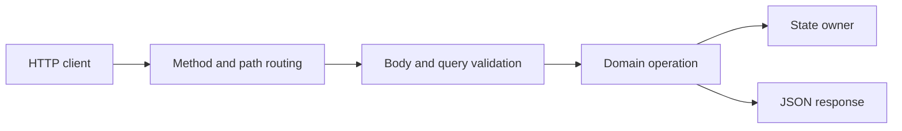

# HTTP clients, handlers, and API design


HTTP is a request/response application protocol commonly transported over TCP; HTTPS adds TLS. A handler implements ServeHTTP(ResponseWriter,*Request). ServeMux routes to handlers. Clients use http.Client and http.Transport, which should be reused for pooling. A TCP connection may carry many HTTP requests; do not assume one request equals one connection. HTTP/2 can multiplex requests over one connection.

```go
mux := http.NewServeMux()
mux.HandleFunc("GET /health", func(w http.ResponseWriter, r *http.Request) {
    w.Header().Set("Content-Type", "application/json")
    _, _ = io.WriteString(w, `{"ok":true}`)
})
```

Method-aware patterns require Go 1.22+. They have defined method/path specificity and conflict rules. Explicit path/method checks are also appropriate for a small teaching API. A `GET` ServeMux pattern also matches HEAD; consider its semantics when designing tests. Use r.URL.Query for URL parameters and strconv to validate numeric bounds. Return 400 for invalid input, 404 for missing resources, 405 with Allow for unsupported methods, 413 for oversized bodies and 500 for unexpected internal failure. Content type is a header, not a substitute for JSON validation.



Write headers before WriteHeader/Write commits the response. Do not attempt to change a 200 to a 500 after streaming bytes. Handlers run concurrently; shared stores require synchronization. Use r.Context for downstream work, since a client disconnect can cancel it. MaxBytesReader bounds request bodies. ReadHeaderTimeout limits header arrival; ReadTimeout covers more of request reading; WriteTimeout and IdleTimeout have different roles. An overall request context timeout still needs cooperative downstream work.

For clients, always close successful response bodies, check HTTP status separately from transport error, bound response bytes, and attach deadlines. Non-2xx responses are usually not a Do error. Drain only an appropriately bounded body when reuse matters; blindly draining infinite data defeats the bound. Keep TLS verification enabled. Do not retry writes automatically without an idempotency policy. Rate limits and Retry-After require deliberate backoff and attempt caps.

httptest.NewRecorder and NewRequest test handlers without sockets. httptest.NewServer/NewTLSServer test real socket transport on unrestricted hosts; this workspace uses an in-memory net.Listener for HTTP and TLS acceptance tests so restricted environments can run them too. The application code still uses ordinary net/http APIs. Test helpers live in internal/testutil and contain no answers.

Solve [HTTP sum handler](../assignments/medium/07-http-handler/README.md) and [JSON client](../assignments/hard/04-http-client/README.md). Completion gate: explain transport errors versus status errors, body ownership, content-type headers, route behavior, request cancellation and concurrent store access. See [net/http](https://pkg.go.dev/net/http).
