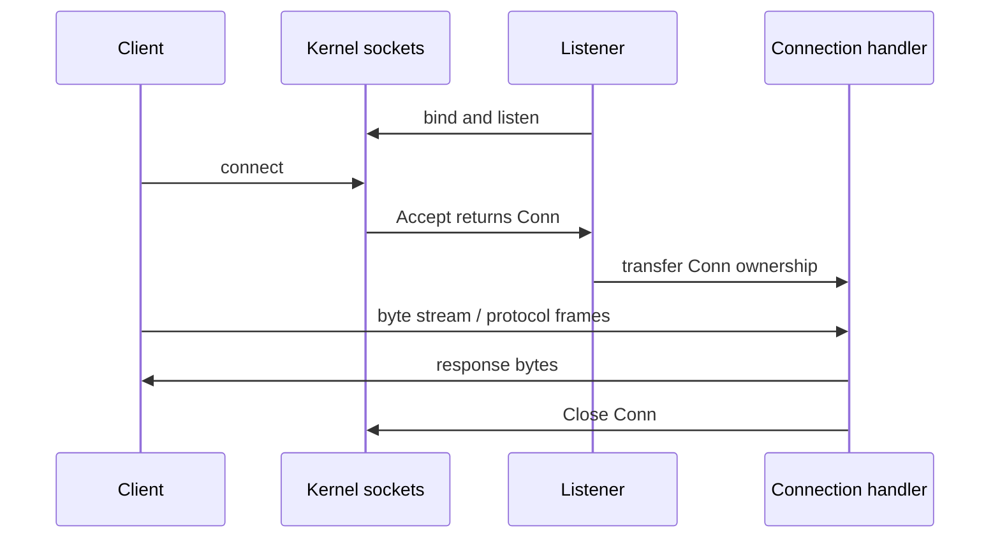

# TCP, UDP, DNS, sockets, and framing


A socket is an OS-managed communication endpoint. A server binds an address and listens; Accept returns a connected stream. A client connects with a dial operation. Go exposes these through net.Listen, Listener.Accept, net.Dialer.DialContext, Conn.Read/Write and Close. `127.0.0.1:0` asks the OS for an ephemeral local port; `:3000` can listen on non-loopback interfaces. Bind explicitly to loopback for local practice.

```go
listener, err := net.Listen("tcp", "127.0.0.1:3000")
if err != nil { return err }
defer listener.Close()
conn, err := listener.Accept()
if err != nil { return err }
defer conn.Close()
if err := conn.SetDeadline(time.Now().Add(5*time.Second)); err != nil { return err }
_, err = io.Copy(conn, conn)
return err
```



TCP is reliable and ordered but has no message boundaries. Read may return fewer bytes than requested; Write boundaries are not preserved. Choose newline-delimited, fixed-width, or length-prefixed framing. io.ReadFull is useful for a fixed header/body. Limit declared sizes before allocation. Handle write errors and partial writes. Set read/write/overall deadlines to avoid waiting indefinitely. Closing a listener unblocks Accept; closing a connection unblocks its I/O. Closing the listener does not itself close every previously accepted connection.

The net runtime integrates network I/O with OS readiness mechanisms; you usually do not need one OS thread per blocked socket. Goroutines let handlers overlap but must be bounded and joined. A shutdown owner should close the listener, stop new work, close or finish existing connections, then wait for handlers. Blocking Read cannot observe a context without a deadline or Close strategy.

UDP is datagram-oriented: ReadFrom/WriteTo preserve a datagram boundary, but delivery, ordering and deduplication are not guaranteed. Read into a sufficiently sized buffer or define truncation policy. net.ListenPacket and net.DialUDP support UDP; net.Resolver.LookupHost/LookupIPAddr perform DNS lookups with context. DNS results and TTL caching are operational concerns; do not hard-code current public addresses into tests. Unix-domain sockets use `net.Listen("unix", filename)` on supporting systems; file cleanup and permissions are part of their lifecycle.

Run `go run ./examples/tcp-echo` and, in a second terminal, `go run ./examples/tcp-client`. Run `go run ./examples/udp` for a local datagram exchange and `go run ./examples/dns localhost`. Solve [framing](../assignments/hard/03-tcp-frames/README.md). Compare with your preserved hello.go: what happens to a second client, a slow client, or a failed Write? Completion gate: explain accept versus read, stream versus datagram, framing, deadlines, DNS and descriptor ownership. See [net](https://pkg.go.dev/net).
