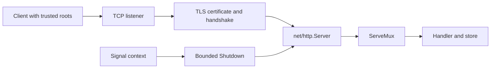

# Build an HTTPS server using only the standard library


HTTPS combines an HTTP application with a TLS-protected connection. The server presents a certificate; the client validates its chain, validity period and hostname/IP SAN. Encryption alone does not establish the server's identity. A self-signed local certificate must be explicitly trusted by the client for the exercise. Do not use InsecureSkipVerify or curl -k as the ordinary solution.



Run the complete local example from the workspace root:

```sh
go run ./examples/certgen -dir .local-certs
go run ./examples/https-server -cert .local-certs/cert.pem -key .local-certs/key.pem
# In another terminal:
curl --cacert .local-certs/cert.pem https://localhost:8443/health
curl --cacert .local-certs/cert.pem https://localhost:8443/time
# Ctrl+C stops the server gracefully.
```

The cert generator uses crypto/ecdsa, crypto/x509, crypto/rand and encoding/pem. It creates a localhost/127.0.0.1/::1 certificate valid for 24 hours and a private key with owner-only permissions. Certificate generation is local development tooling, not a production CA. Keep private keys out of version control. It refuses to overwrite existing files; remove or choose a new directory when regenerating.

Construct an explicit http.Server with the handler, timeouts and tls.Config.MinVersion; call ListenAndServeTLS or ServeTLS. You do not need a framework to serve HTTPS. In this example TLS 1.2 is the minimum and Go handles current default cipher selection. ListenAndServeTLS with a populated server has different lifecycle concerns from the package convenience helper: using an explicit server lets you call Shutdown and configure bounds.

Use signal.NotifyContext for SIGINT/SIGTERM. When it is canceled, call Shutdown with a fresh context.WithTimeout(context.Background(),5*time.Second). Shutdown stops accepts and waits for ordinary active requests. If the grace period expires, Close stops remaining connections and the application reports the shutdown error. Join the server goroutine. Long-lived hijacked/WebSocket connections need additional tracking; Shutdown does not own them automatically.

For real deployment obtain a certificate from a trusted CA, automate renewal, handle secret storage, decide whether TLS terminates at your process or at a reverse proxy, and document trusted proxy headers. The standard library can serve provided certificate files; it does not supply a complete ACME certificate issuance/renewal service. Mutual TLS additionally authenticates clients using ClientAuth and ClientCAs; only enable it with a concrete client-certificate policy. HTTPS does not replace application authorization or input validation.

Solve [HTTPS lifecycle](../assignments/hard/05-https/README.md). Its tests perform a real TLS handshake over net.Pipe with an explicitly trusted generated certificate and check shutdown/startup failure behavior. Completion gate: explain SANs, trust roots, listener ownership, each timeout, graceful versus forced shutdown and certificate renewal responsibilities. A port-restricted sandbox can run the tests even when it cannot run the interactive listener example.
