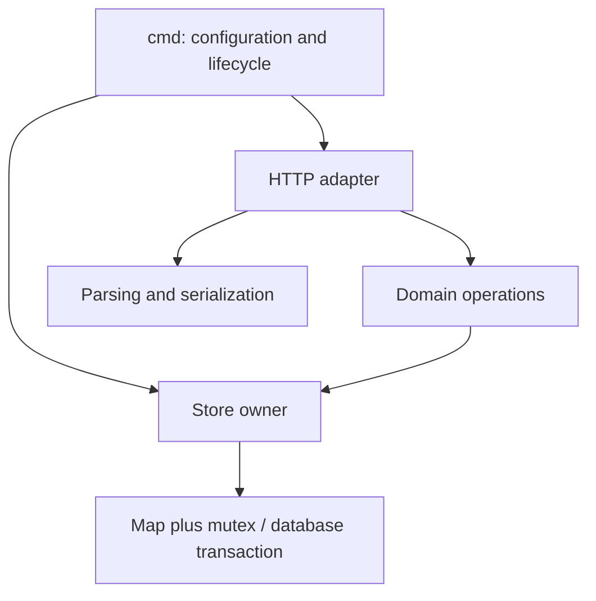
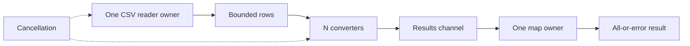

# Architecture, maintainability, and a streaming capstone

Architecture explains responsibilities, dependencies, state ownership and failure behavior. Begin with a simple concrete program. Separate concerns when they change independently or need separate tests; avoid creating layers with no purpose. A small service might use cmd for entry-point wiring, a handler for HTTP parsing, a service for business rules and a store for mutable persistence. Keep dependencies pointed inward: domain rules should not require an http.ResponseWriter.

Use constructors to establish invariants and inject only dependencies you need: a clock, a reader, a reusable client, or a narrow repository interface. Do not put a global mutex and map in unrelated packages. Document whether returned slices/maps are snapshots or shared mutable views. Value records are often convenient because they do not leak internal pointers. The caller that creates a long-lived component normally owns stopping it; use explicit Close/Shutdown where needed.

For concurrent pipelines, each stage owns its mutable state. A reader stage parses records, workers convert independent records, and one reducer owns aggregation. Bounded channels prevent memory growth from a fast producer. Cancellation must reach every blocking channel operation. A coordinator closes output after all workers exit. Reader I/O cancellation still depends on an owner capable of unblocking Read. There is no universal context wrapper that can force any Reader to stop safely.

Solve [CSV pipeline](../assignments/hard/06-csv-pipeline/README.md), then the [repair-shop interview](../interviews/repair-shop/README.md). These combine parsing, data structures, concurrency, validation, ownership and testing. The repair task is an original local teaching repository, not a claimed company question. Public company repositories are separately catalogued in interviews/README.md with provenance and prerequisites.

An advanced extension is durable storage with database/sql. The standard library exposes connection-pool/transaction abstractions but includes no general SQL driver. This course deliberately remains dependency-free: first implement the in-memory contract, then choose a driver and database explicitly in a separate module. Use BeginTx/Commit/Rollback, parameterized SQL, context deadlines and migrations. A mutex transaction in one process is not a database transaction across processes.

Further study: idempotency keys, authentication/authorization, rate limiting, structured log/slog logs, request IDs, health versus readiness, pagination consistency, bounded caches, graceful deployment, observability and failure injection. Distributed systems add retries, duplicate messages, ordering and partial failure; a goroutine does not make those problems disappear. See [advanced study](../docs/advanced-study.md).

Completion gate: draw the repair-shop request path, name the owner of its map, explain import atomicity, choose an error-to-status mapping, and show how a slow dependency is bounded. Keep that diagram synchronized with your implementation.
