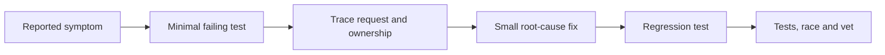

# Tests, fuzzing, profiling, and repository repair interviews


A good test states externally visible behavior. Table-driven cases cover valid values, boundaries, malformed input and ownership. Check error identity with errors.Is/As rather than error text. Use t.TempDir for files, injected clocks for time, Recorder for handlers and net.Pipe for streams. Use an actual TLS handshake when TLS behavior is the property being checked. Tests should fail for plausible wrong implementations, not just mirror the same algorithm.

```go
func TestEmpty(t *testing.T) {
    _, _, _, _, err := Stats(nil)
    if err == nil { t.Fatal("empty input must fail") }
}
```

```sh
make test                              # completed reference code and examples
make check ID=medium/06-worker-pool      # one learner assignment
go test -race -count=1 ./solutions/...
go vet ./...
go test -run '^$' ./assignments/...      # compile unsolved packages only
go test -bench . -benchmem ./examples/testing-tools
go test -fuzz FuzzReverse -fuzztime 5s ./examples/testing-tools
```

The root-wide ordinary test suite intentionally fails until all starters and repair defects are solved. The verify script instead compiles starters, checks matching acceptance tests, runs solutions with -race and vets local packages. Race detection may require a supported platform and C toolchain. A time-limited test prevents a deadlock from hanging indefinitely, but it is not itself a cancellation implementation.

Fuzzing explores many generated inputs. Define properties such as reversing twice restores a valid UTF-8 string, or encoding then decoding round-trips a value. A property must match the contract: decoding may intentionally normalize a value, and rune conversion replaces invalid UTF-8. Keep discovered regressions in the corpus. Benchmarks report allocations and throughput; compare equivalent work, avoid drawing conclusions from one noisy run, and measure before optimizing.



In a 60–90 minute repair interview: spend 10 minutes reading the README, entry point and architecture; 10 minutes reproducing and prioritizing; 35–50 minutes fixing with a regression test per bug; 10 minutes running checks; and 5–10 minutes explaining changes and risks. Start with the highest-impact reproducible issue. Preserve exported APIs unless the task authorizes changing them. Avoid broad refactors before understanding expected behavior. See [interview workflow](../interviews/WORKFLOW.md).

Use Delve for interactive debugging when available; it is an external tool, not needed for these tests. Standard diagnostics include `go test -cpuprofile`, `-memprofile`, `go tool pprof` and `go test -trace` / `go tool trace`. CPU samples identify hotspots; heap profiles identify allocations/retention; traces reveal scheduling and blocking. Never expose an unprotected net/http/pprof endpoint publicly. The race detector finds executed races, not semantic correctness or all races. See [official diagnostics](https://go.dev/doc/diagnostics) and [fuzzing tutorial](https://go.dev/doc/tutorial/fuzz).

Completion gate: reproduce one repair defect with a failing regression, explain why the fix addresses the cause, and report checks honestly. If a test was not run because its environment is unavailable, say so rather than treating a compile as a passing integration test.
