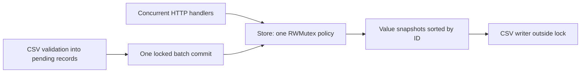

# Repair Shop: reference implementation and explanations

This is the solution to [the original local repair lab](../../../interviews/repair-shop/README.md),
not an official answer to any company repository. Tests are identical to the starter's.

```sh
go test -race -count=1 -timeout=30s ./solutions/interviews/repair-shop/...
go run ./solutions/interviews/repair-shop/cmd/server
```

| Symptom | Root cause | Fix and regression |
| --- | --- | --- |
| Invalid titles saved | Create checked raw length only | Use the shared trim + rune-count validator before mutation; TestTitlesAndSnapshots |
| Missing task returned 200 | Get returned nil error on absent key | Return ErrNotFound; HTTP maps it to 404; TestMissingResources and TestHTTPBoundaries |
| Reopen ignored | Complete always assigned true | Assign the supplied bool; TestReopenAndStats and HTTP PATCH false |
| Large offset panics | List checked equality only | Guard offset>=len before slicing; TestPaginationAndOrder |
| Wrong pages/order | Snapshot comparator reversed the contract | Sort ascending once at snapshot boundary; TestPaginationAndOrder and TestSearch |
| Failed import leaves rows | Store mutation occurred during parsing | Stage validated records, then commit under one lock; TestImportAtomicity checks state and next IDs |
| Export hides writer failure | Buffered flush error was discarded | Flush then return writer.Error(); TestExportFlushFailure injects a failing writer |
| Extra JSON accepted | Second Decode's successful extra value was ignored | Require exactly io.EOF after first value; TestHTTPBoundaries |

## Architecture and ownership



One lock protects IDs, map entries and the injected clock's use. Reads returning Task copy
values; Snapshot copies records into a new slice. No pointer to an internal record escapes.
Stats holds one read lock for a consistent count. Search works on a snapshot and preserves
its order. The store must not be copied after first use. A future database implementation
would need transaction semantics rather than assuming this mutex works across processes.

CSV parsing is all-or-error: validation does not allocate IDs or mutate the map. Commit
holds the write lock once, making the batch invisible until complete to other locked
operations. Staging requires O(batch size) memory. There is no total file/record-size cap,
so an HTTP import adapter would need additional bounds before accepting untrusted files.
Export copies first to avoid holding locks over a slow/failing sink. Flush is necessary
because csv.Writer buffers: a successful per-row Write can still be followed by failure.

HTTP keeps parse/status concerns outside the store. Body reading is bounded before decode,
required fields use pointers, unknown keys are rejected, and the second Decode requires
EOF. JSON marshaling occurs before headers commit. Response write errors cannot change an
already committed status; a larger service could record them in bounded structured logs.

The command owns the server goroutine, receives signal cancellation, calls Shutdown with
a fresh five-second context, force-closes on expiry, and joins. No request launches hidden
background work. The in-memory store is unbounded and non-durable; authentication,
authorization, persistence and TLS are separate requirements, not silently claimed features.

## Complexity

Create/Get/Complete/Delete are expected O(1). Snapshot/List/Search/Export copy and sort in
O(n log n) time and O(n) extra space. Stats is O(n). Import is O(input bytes + batch size)
and O(batch size) staging memory. Search also scans title bytes. These choices favor a
small clear teaching service; large datasets need indexing and stable pagination policies.

After studying, reimplement each fix in the learner directory without copying files, and
explain why the regression would fail for the old behavior. Use a separate regression_test.go
for additional learner tests so the original acceptance suite remains easy to compare.
